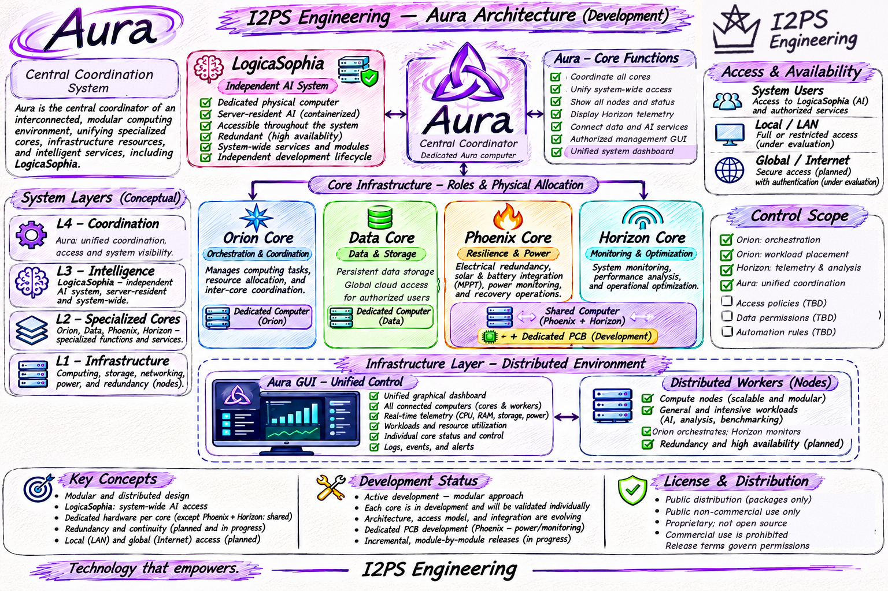

# Aura

### Modular Distributed Computing Infrastructure

**An I2PS Engineering Project**  
**Status: Active Development — Modular & Evolving**

## 1. Overview

Aura is a modular, distributed computing infrastructure project developed by **I2PS Engineering**. Formerly known as **Atlas Nexus**, Aura is the **central coordination system** for a network of dedicated physical computers, specialized cores, distributed computing workers, shared data services, electrical infrastructure, and independent artificial intelligence.

The vision is to build an interconnected environment that can be accessed by authorized users from anywhere. Aura will provide a unified view of the entire infrastructure and an interface to its available services. The underlying functions remain separated: **Aura coordinates; Orion orchestrates; Horizon monitors and supports optimization; Data Core handles storage and cloud services; Phoenix Core addresses electrical redundancy; LogicaSophia provides AI services.**

This README is an **engineering roadmap**, not a declaration that all the described capabilities are operational. The project is being designed, developed, tested, and integrated **module by module**. Engineering updates and releases will be published when the relevant work is ready, without externally imposed deadlines.

## 2. Physical Architecture — Dedicated Computers

The system is based on **physically separate computers**, not a collection of virtual labels on one machine. **Horizon Core and Phoenix Core are the only two cores intended to share a physical computer.**

| System | Physical assignment | Principal role |
| --- | --- | --- |
| **Aura** | Its own dedicated computer | Central coordination, system visibility and unified GUI |
| **Orion Core** | Its own dedicated computer | Orchestration of tasks and distributed computing resources |
| **Data Core** | Its own dedicated computer | Storage, persistent data services and cloud-style access |
| **Horizon Core** | Shares one physical computer with Phoenix Core | Monitoring, telemetry and optimization support |
| **Phoenix Core** | Shares that same computer with Horizon Core | Electrical redundancy, power-system monitoring and resilience |
| **LogicaSophia** | Its own dedicated computer | Independent AI system and containerized AI services |
| **Computing workers** | Multiple additional physical machines | Processing capacity for distributed workloads |

A dedicated primary machine does not mean a component can never use other resources. In particular, **LogicaSophia is designed to use additional distributed compute resources through a containerized environment**. The placement, allocation and redundancy mechanics for these services are ongoing engineering work.

The computing-worker fleet is deliberately heterogeneous: different processors, memory configurations, storage devices, operating environments and performance characteristics can be evaluated and integrated. There is no fixed final worker count.

## 3. Aura — Central Coordinator

**Dedicated physical computer.**

Aura ties the infrastructure together as a coordinated environment. It is the primary system-wide management and visibility layer, **not** the engine that schedules computing workloads.

Aura's intended responsibilities are to:

- Connect the specialized cores and make their services discoverable through a unified environment.
- Present a coherent view of the entire infrastructure, including its physical nodes, service status and operational conditions.
- Expose authorized management and service-access functions through a unified graphical interface.
- Bring together information originating from Orion, Horizon, Data Core, Phoenix and LogicaSophia.
- Support authorized access to the infrastructure from beyond the local network.

Coordination does not imply unrestricted control. The final division between observation, user-level actions, administrative actions and sensitive infrastructure controls is being designed as part of the access and security work.

### Aura Unified Graphical Interface

The **Aura GUI** is a core requirement of the roadmap, not an optional illustration. It is intended to provide a central, navigable view of the whole installation:

- **Every node:** identity, connectivity, operational condition and availability.
- **Live telemetry:** relevant CPU, memory, thermal, storage, network and resource-usage measurements as supported by each node.
- **Workloads:** active work, available capacity and orchestration activity reported by Orion.
- **Horizon:** monitoring data, trends, performance analysis and optimization information.
- **Data Core:** available storage resources, data-service status and authorized access.
- **Phoenix:** electrical conditions, power-system information and resilience status as the hardware is developed.
- **LogicaSophia:** access to available AI services for authorized users and participating modules.
- **System management:** approved controls, user/service access and administrative actions as those interfaces are implemented.

The actual screens, permissions, control behavior and client technologies are implementation work in progress. The roadmap does not claim a finished interface or working remote-control feature today.

## 4. Orion Core — Distributed Orchestration

**Dedicated physical computer.**

**Orion is the orchestrator.** Its role is to organize work across the available compute resources. In practical terms, it needs to know which workers are present, what resources they have, what work is already running and where a new task should be placed.

Orion will use information supplied by Horizon to support decisions such as:

- Which nodes are connected, available or occupied.
- Which workers have sufficient CPU, memory or other resources for a workload.
- Where work can be placed according to system conditions and workload requirements.
- How work and containerized services should be coordinated across machines.
- How changes in worker availability should be reflected in orchestration.

**Docker and Kubernetes** have been discussed as technologies relevant to this work. Containerized services and cluster orchestration are part of the implementation roadmap; their final configuration is not being asserted here.

The precise scheduling algorithms, communication protocols, service discovery, workload recovery and restart policies will be designed and evaluated during implementation. There is no need to pretend those decisions have already been finalized.

Earlier architectural discussions also associated **Copernicus-related functions** with Orion. Their detailed scope will be documented when established rather than inferred here.

## 5. Horizon Core — Monitoring, Telemetry and Optimization

**Shared physical computer with Phoenix Core.**

Horizon observes the distributed environment and supplies the information needed for resource-aware orchestration and system visibility.

Its intended monitoring includes, as supported by the connected machines:

- Processor activity, utilization and performance.
- Memory usage, availability and relevant performance characteristics.
- Temperature, system health and hardware conditions.
- Workload status and resource consumption.
- Storage and network-related operating information.
- Node state, availability, telemetry history and operational trends.

Horizon evaluates operating conditions and supports optimization. **It does not replace Orion as orchestrator.** The working relationship is direct: **Horizon monitors and reports; Orion determines how to orchestrate work.** Aura then presents the combined information through its unified GUI.

Collection mechanisms, telemetry agents, analysis methods, optimization algorithms, storage and communication interfaces are being developed progressively.

## 6. Data Core — Storage and Cloud-Style Access

**Dedicated physical computer.**

Data Core is the infrastructure's specialized storage and data-services system. Its scope includes persistent data, shared storage services and the organization and availability of data needed by connected modules and authorized users.

**Global access is an explicit design requirement.** Data Core is not intended to be restricted to the local server room or LAN: the objective is cloud-style access from anywhere, consistent with Aura's overall remotely accessible architecture.

The roadmap includes:

- Persistent storage and management of data resources.
- Data services for the specialized cores and supported applications.
- Authorized access to stored information across the infrastructure.
- Cloud-style remote availability to authorized users.
- Future data protection, replication, backup and recovery arrangements as those requirements are engineered.

The specific storage stack, external endpoints, data exposure model, authentication, authorization and replication design are **ongoing engineering work**. Worldwide accessibility does **not** mean anonymous or unrestricted access, and no particular availability guarantee is claimed.

## 7. Phoenix Core — Electrical Redundancy and Power Resilience

**Shared physical computer with Horizon Core.**

**Phoenix Core's primary established responsibility is electrical redundancy.** It is not merely a generic software backup component.

Phoenix focuses on the electrical infrastructure that supports the computers and their continuity of operation. The engineering scope includes:

### Redundant electrical power

Developing and coordinating redundant supply arrangements, electrical monitoring and power-continuity strategies. Switching behavior, source selection, protection and electrical failover will be designed and validated as the hardware work progresses.

### Solar, batteries and charging

The project includes **Atlas Solar battery equipment**, solar-power integration and **MPPT-related hardware**. Phoenix is intended to work with the monitoring and electrical-management functions relevant to these systems.

### Dedicated electronics and PCBs

PCB-based monitoring and related electronics are part of Phoenix's development roadmap. Detailed circuitry, electrical interfaces, switching designs and test evidence will be published when the engineering work reaches the appropriate stage.

### Resilience and system continuity

Phoenix contributes electrical and hardware-level information to the wider infrastructure's resilience objectives. It may cooperate with other cores where needed, but it does **not** take over Orion's workload orchestration or Horizon's general compute telemetry.

Some supporting power hardware has been acquired and evaluated independently; that does **not** establish that the entire Phoenix design, automatic switching or end-to-end failover is already tested. These are active engineering subjects.

## 8. LogicaSophia — Independent, Distributed AI Services

**Dedicated physical computer.**

**LogicaSophia** is an independent I2PS Engineering AI project with its own repository, development lifecycle, interface and releases.

Within Aura, it is intended to reside in the server infrastructure, remain **redundant**, and provide AI capabilities to **multiple users and modules throughout the system**. It is not a detached third-party AI service, and it is not the system's workload orchestrator.

LogicaSophia has its own primary computer, with a **containerized environment intended to take advantage of additional resources across the distributed infrastructure**. The details of container deployment, resource allocation, redundancy and service interfaces are to be developed and tested through integration with the wider system.

For the current implementation, application GUI, documented features and release details, consult the separate **[LogicaSophia repository](https://github.com/I2PS-Engineering/LogicaSophia)** and its README. Aura's README describes the intended infrastructure relationship; it does not substitute for LogicaSophia's project documentation or imply that planned integrations are already shipped.

## 9. Distributed Workers and Networking

Additional physical computers form the worker fleet. The infrastructure can grow incrementally and is intended to support dissimilar hardware rather than only identical nodes.

The ongoing engineering work includes:

- Evaluating each computer's sustained performance, memory behavior, temperature, utilization and stability.
- Connecting and identifying nodes over the supported **LAN and WLAN** environment.
- Unifying worker visibility so that machines can be inspected from Aura rather than managed entirely in isolation.
- Preparing network switching, addressing and connectivity for a larger fleet.
- Making the resources of validated workers available to Orion's orchestration and, where designed, to LogicaSophia's computing needs.

The project has used recycled and repurposed computers for sustained workload testing. Such hardware validation provides evidence about individual machines; it is **not** presented as proof that the complete Aura system has been deployed.

Network segmentation, worker enrollment, authentication, secure remote administration and cluster policy will be established during development.

## 10. Remote Access, Authorization and Security

Aura and Data Core are intended to be accessible from **anywhere**, and LogicaSophia is intended to serve authorized users across the system.

That is an architectural goal, while **how access is granted and controlled is an implementation task**. Areas under active consideration include:

- User identity, authentication and authorization.
- Role and permission boundaries for users, operators and services.
- Remote GUI access, remote management and secure connectivity.
- Separation of data access from infrastructure administration.
- Protection of electrical controls and other sensitive hardware functions.
- Service interfaces and secure communication between cores and workers.

No single authentication product, remote-access protocol, exposure method or privilege model is declared finalized in this roadmap.

## 11. Engineering and Integration Roadmap

This is an **independent, pro bono engineering project**. The work is organized around modules and engineering readiness, not promised delivery dates.

The areas of work include physical hardware preparation; Orion orchestration and Docker/Kubernetes evaluation; Horizon telemetry and optimization; Data Core storage and remote access; Phoenix electrical redundancy, MPPT and PCB work; LogicaSophia resource integration; Aura's GUI; networking; authentication; and full-system validation.

Each core is developed and validated individually, then integrated progressively as interfaces and dependencies are established. The architecture may evolve in response to practical tests.

When an engineering milestone is completed and suitable for publication, **the repository will be updated and the relevant files may be released**. Some components may be released separately. There is **no fixed release schedule** and no obligation to publish unfinished work.

### Understanding the status

- **Architectural direction:** a stated design goal or approved system responsibility.
- **Work in progress:** design, implementation or testing under way.
- **Validated:** behavior supported by actual engineering tests and evidence.
- **Released:** a package or module made available for public use.

An item appearing in a conceptual diagram or checklist is **not automatically a completed or validated feature**.

## 12. Public Use and Licensing

**Aura is not open-source software.**

The project is intended for **public, non-commercial use only**, through releases made available by I2PS Engineering. **Commercial use is not permitted.** Public visibility of a repository does not by itself mean that proprietary source code is licensed for reuse, redistribution or commercial exploitation.

The applicable permissions and restrictions for any distributed package will be specified by its accompanying release terms. No additional rights should be inferred from this architectural README.

The project is developed pro bono and independently; updates and releases are provided when engineering work is ready.

## 13. Project Vision

Aura is intended to bring together a physically distributed computing environment with distinct and cooperating responsibilities:

**Aura coordinates. Orion orchestrates. Horizon monitors and supports optimization. Data Core provides storage and cloud-style services. Phoenix Core addresses electrical redundancy and power resilience. LogicaSophia provides independent, system-wide AI services.**

The supporting worker fleet supplies additional computing resources. The unified Aura GUI is intended to make the complete environment visible and accessible from anywhere to authorized users.

Development proceeds **module by module**, with engineering decisions, testing and releases documented as the project matures.

---

*Technology that empowers.*

**I2PS Engineering**

*Status: Development (Modular & Evolving)*
